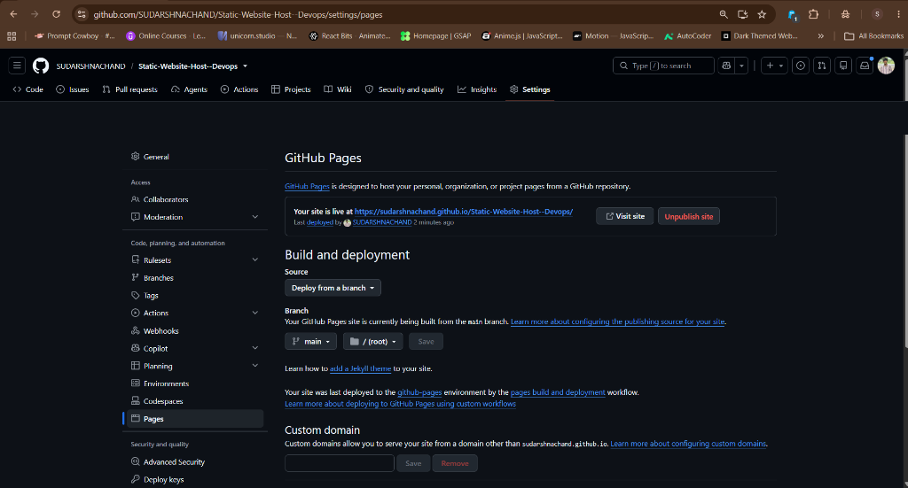

# DevOps & Cloud Roadmap 2027

A responsive static website for planning and tracking my journey
towards a DevOps and Cloud Engineering career.

🔗 **Live Website**: [https://sudarshnachand.github.io/Static-Website-Host--Devops/](https://sudarshnachand.github.io/Static-Website-Host--Devops/)

## Features
- Four-phase learning roadmap for 2027
- Interactive skill completion checklist
- Browser-based progress tracking
- Projects and achievement tracker
- Responsive dark-themed interface

## Technologies
- HTML5
- CSS3
- JavaScript
- Git and GitHub
- GitHub Pages

## Run Locally
Open `index.html` in your browser.

## Deployment & Hosting

The static website is deployed and hosted live using **GitHub Pages**:

### Steps Followed for Deployment:
1. Pushed the project repository to GitHub (`main` branch).
2. Navigated to repository **Settings** → **Pages**.
3. Under **Build and deployment**, selected **Deploy from a branch**.
4. Chose branch `main` and folder `/ (root)`.
5. Saved and confirmed deployment. Website is live at the official GitHub Pages URL.

## Career Goal
Develop practical skills in Linux, Git, Docker, CI/CD,
cloud platforms, Terraform, Kubernetes and monitoring.
